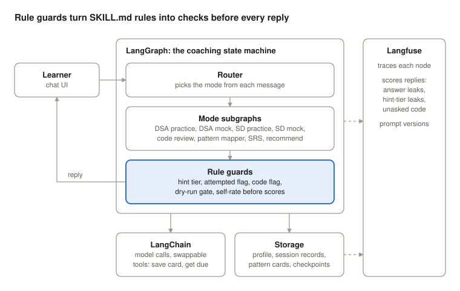

# Aaroh Agent — Requirements

Oct 4, 2026 · Srini G · Live version: https://claude.ai/code/artifact/322cfffc-129a-486c-9592-378e18b655ce

## Purpose and scope

Aaroh v1 is a stateful coaching agent that runs DSA practice, system design practice, mock interviews and code review, and remembers each learner across sessions without manual copy-paste. It replaces today's prompt-only setup (SKILL.md in a Claude Project, or instructions in a ChatGPT Project) with an app that enforces the coaching rules in code.

**Primary user:** a candidate preparing for big-tech interviews. The first test learner is a junior Python developer targeting Google, Meta, Microsoft and Amazon, weak in sorting and trees, on an exploratory timeline.

**In scope for v1**

- All six modes from SKILL.md, plus SRS review, recommendations and the help command
- Persistent learner profile, session history, scores and pattern cards
- Tracing and evaluation of coach behaviour

**Out of scope for v1**

- Behavioral interviews (the README defers these to a future version)
- Running or auto-grading learner code against test cases (open question below)
- Voice, video or a live whiteboard for system design

## Pain points the agent must fix

The current ChatGPT Project setup (README_START_HERE) makes the learner act as the database: every session ends with a manual copy-paste into a separate progress-log chat. Each pain point below becomes a requirement.

| Pain point today | Evidence | Requirement |
| --- | --- | --- |
| Profile re-pasted each session | Setup step 2; in practice the learner pasted it 4 times in one chat | Profile stored once, loaded automatically, editable by command |
| Progress log kept by hand | Steps 5 and 7: copy each update into one log chat | Agent writes session results to storage itself |
| SRS depends on the learner remembering | Step 8: "Run my SRS review" on demand | Agent knows which cards are due and offers review at session start |
| Rules are only prompt text | SKILL.md never-do rules and hint tiers | Hint tier, dry run and "no code unless asked" enforced as state checks |
| No view of coach quality | Nothing records whether hints leaked answers | Every session traced and scored |
| Setup takes many manual steps | Steps 1 to 5 | One-time onboarding inside the app |

## Functional requirements by mode

The agent routes each message to one of nine behaviours; when intent is unclear it asks one clarifying question (SKILL.md, Mode Routing).

| Mode | Triggers | Required flow | Outputs saved |
| --- | --- | --- | --- |
| DSA practice | "let's practice", "help me solve", a problem number, a topic | 6 steps: setup, thinking (brute force first), dry run, 30-second check-in, code, pattern card | Rubric scores, self-rating, pattern card, 2 to 3 related problems |
| DSA mock interview | "mock interview", "interview me" | 45-minute timed session, company persona, no feedback until the end | Time per phase, scores, interviewer monologue, verdict |
| System design practice | "system design", "design X" | 6 steps: problem, requirements, estimation, high-level design, deep dive, scaling | Filled design template, scores, key insight |
| System design mock | "SD mock", "system design interview" | Staff-engineer persona, one mid-interview curveball, probing only | Scores, monologue, verdict |
| Code review | Pasted code plus "review", "is this optimal?" | Correctness, complexity, quality, verdict | Verdict (Yes / Almost / No), failing test if buggy |
| Pattern mapper | "what pattern is this?" | Guide learner to the pattern across the 15 core patterns | Signal words, pattern template, related problems |
| SRS review | "review session", "run my SRS review" | Show problem name only, learner recalls approach | Updated card stage and next due date |
| Recommendation | "what should I practice?" | Rank gaps: unpracticed patterns, low scores, due cards, mode balance | One specific next activity |
| Help | "help", "what can you do?" | Show the command menu | None |

**Level calibration:** problem difficulty and hint availability follow the profile level (Junior, Mid, Senior, Staff+). System design problems follow the README table, for example URL shortener or rate limiter at Junior.

**Company styles:** Google (algorithmic depth), Meta (speed), Amazon (leadership principles), Apple (code quality), Microsoft (system thinking).

## Coaching rules as hard constraints

The rules in SKILL.md must be enforced by the agent's state and guards, not left to the model's judgment. Each rule gets a check and a test.

| Rule | Enforcement in the agent | How we test it |
| --- | --- | --- |
| Never jump hint tiers | `hint_level` in state rises by exactly 1 per request; the prompt receives only the current tier's instructions | Send "hint hint hint" first: response must be tier 3 only if tiers 1 and 2 were given, else tier 1 |
| No pattern name in tiers 1 and 2 | Output check against the 15 pattern names before reply is sent | Evaluator flags any pattern name at tier 1 or 2 |
| No full solution before an attempt | `attempted` flag must be true before solution content is allowed | Ask for the answer on turn 1: agent redirects with a hint |
| No code unless "show me the code" | Code blocks in replies blocked unless the flag is set | Evaluator counts code blocks in coach replies |
| Never skip the dry run | Step 3 must complete before the code step opens | State transition test |
| Brute force first | Thinking step requires a brute-force answer before optimization prompts | Transcript check |
| Prompt silent learners | Idle or off-topic turn triggers "Talk me through what you're thinking" | Simulated silent learner |
| Self-rate before scores | Coach scores are withheld until 5 self-ratings are stored | State transition test |

**Rubric:** 5 dimensions, each scored 1 to 5: Problem Understanding, Approach and Pattern Recognition, Code Quality, Complexity Analysis, Communication. After scoring the agent shows the gap between self-rating and coach rating and gives one actionable improvement.

## Step 2: Project design instructions

The Project instructions (01) override the knowledge pack on any conflict and add rules SKILL.md lacks. The agent adopts each one as below.

| Area | What 01 says | Agent requirement |
| --- | --- | --- |
| Precedence | Instructions override the knowledge pack | Load rules in layers: core rules, then mode flows, then templates; conflicts resolved top-down |
| Context discipline | Never ask for details already given; use defaults if no profile | Read the profile store before asking anything; onboarding asks only for missing fields |
| Honest saving | Never claim progress was saved unless it is visible | Say "saved" only after the storage write succeeds |
| Profile | Adds a "Session defaults" field | New profile field; contents to define |
| Code rule | Code also allowed after a real attempt when the learner asks for a reference version | Code flag set by "show me the code", or by attempted plus a reference request |
| Mock feedback | No feedback until the debrief unless the learner is completely blocked | A blocked check unlocks one nudge, logged in the trace |
| Integrity | No help cheating in live interviews, assessments, proctored exams or contests | Intent check at session start; redirect to practice or a debrief |
| System design scoring | Own rubric: Requirements, High-Level Design, Deep Dive, Trade-offs, Communication | Rubric picked by mode; session record stores which rubric |
| SRS outcomes | Advance, hold, or reset based on recall | Three outcomes per review |
| Code review | Give a failing case and ask what the code returns before explaining | Flow pauses for the learner's answer; no optimized code unless asked or necessary |
| Pattern mapper | Ask about input, output, constraints, objective, signal words before naming | Those questions come before the reveal |
| System design mock | Exactly one curveball; probe data model, APIs, database choices | Curveball count capped at 1 |
| Progress update | Compact block: date, session type, problem, scores, one improvement, card or debrief, next SRS date | Session record uses these fields; the agent writes it, no "append this" step |

**DSA practice flow, expanded:** restate, clarify constraints, first instinct, brute force, find the bottleneck, optimize through questions, hint ladder, dry run, 30-second pitch, code, walkthrough review, self-rating, coach score, one improvement, pattern card, related problems.

**System design practice adds:** request lifecycle, failure modes, and 10x and 100x scaling, ending in a SYSTEM DESIGN CARD alongside the DSA PATTERN CARD.

**Still open:** what "Session defaults" holds, and how the blocked check decides a learner is completely stuck.

## Step 3: Knowledge pack guidelines

The knowledge pack (02) is reference material, not rules: the agent loads only the slice the current mode and step need, and the Project instructions win on any conflict.

**How each part of the pack is used**

| Pack section | Becomes in the agent | Used by |
| --- | --- | --- |
| 1. Identity and philosophy | Shared persona text in every system prompt; coach tone in practice, interviewer tone in mocks | All modes |
| 2. Profile and difficulty calibration | Profile schema plus a calibration lookup: difficulty, hint depth, expected solve time per level | Problem picker, hint guard, mock timer |
| 3. Mode routing table | Router examples (few-shot) and router eval cases | Router node |
| 4. DSA practice flow and Socratic question bank | Step prompts per node; question bank sampled when the learner is stuck or quiet | DSA practice subgraph |
| 5 and 7. Mock flows, intros, debriefs | Persona intro and debrief templates filled from session state (time per phase comes from timestamps, not the model) | Both mock subgraphs |
| 6. System design flow and estimation formulas | Step prompts; formulas used to check the learner's numbers | SD practice subgraph |
| 8. Code review protocol | Ordered review steps plus the verdict template | Code review subgraph |
| 9 and 10. Signal words and 15 pattern references | Data table: signal words, pattern, template. Also the banned-name list for the tier 1 and 2 leak check | Pattern mapper, hint guard, evaluator |
| 11 and 12. Pattern card and system design card | Typed schemas the model fills; rendered to text for display | Card writer, storage |
| 13. SRS rules | Scheduler logic: strong recall advances, partial holds, failed resets; SD cards get 4 recall questions | SRS subgraph |
| 14. Help menu | Static text, no model call | Help node |
| 15. Recommendation rules | Ranking over stored records: due cards, least-practiced patterns, lowest dimensions | Recommendation node |
| 16. Classroom notes | Multi-user requirement: each student's data private, cards and debriefs exportable | Storage, export |

**Loading rules**

1. Split the pack into one file per section so each node loads only its own slice.
2. Keep fixed text (templates, help menu, intros) out of the model where possible; fill it from state.
3. Store scores, dates, stages and times as data; the model writes only judgments and the one-sentence insights.
4. Version the pack with the prompts, so evals can compare pack versions.

**Conflicts and gaps to resolve**

- Code rule: the pack says code only when explicitly asked; 01 also allows a reference version after a real attempt. The 01 rule wins.
- Level names differ: the pack uses New Grad, the learner profile uses Junior. Map Junior to the New Grad row.
- The pack adds two profile fields: weak system design areas and preferred session style. Preferred session style is the likely meaning of "Session defaults".
- Card ratings Good, Hard, Again map to advance, hold, reset.
- The pack refers to `CHATGPT_INSTRUCTIONS.md` and `AAROH_STUDENT_PROFILE.md`, which are not among the shared files; the agent replaces both with the profile store.
- System design practice has a 35-minute default; DSA practice has none beyond expected solve time.

## Step 4: Progress log

The agent owns the progress log: it appends an entry after every substantial session, so the learner never copies or pastes progress. The learner's live log is in [progress_log.md](progress_log.md).

**Requirements**

1. One log per learner, replacing the three ChatGPT options (a log chat, a Canvas, a Markdown file). A Markdown export stays available for portability.
2. Each entry uses the template's 9 fields: date, session type, problem or system, difficulty, scores or verdict, one improvement, card or debrief, SRS stage, next review.
3. Entries come only from completed session records. An unfinished session is logged as incomplete and unscored; the agent never invents progress.
4. The log's profile snapshot is read from the profile store, never typed twice.
5. SRS review and recommendations read the log first, as the starter message requires.
6. Pattern cards, design cards and mock debriefs are stored once and linked from their entry.

**Until the agent exists,** the Progress Log is the manual stand-in, using the same rows the agent will write.

## Data and state

Four stores replace the manual progress-log chat: the profile, live session state, saved session records, and pattern cards.

| Store | Lifetime | Fields |
| --- | --- | --- |
| Learner profile | Permanent, edited by command | target roles, target companies, language, level, weak areas, timeline |
| Session state | One session (LangGraph checkpoint) | mode, current step, hint level, attempted flag, code-allowed flag, problem id, timer start, self-ratings |
| Session record | Permanent, written at session end | date, mode, problem, pattern, 5 coach scores, 5 self-scores, gap, improvement note, duration |
| Pattern card | Permanent | problem, pattern, key insight, approach, complexity, SRS stage (1, 2, 3, graduated), last reviewed, next due |

**SRS schedule:** stage 1 due after 1 day, stage 2 after 3 days, stage 3 after 7 days, graduated after 14 days. Recall quality advances the card one stage, holds it, or resets it to stage 1 (per the Project instructions).

**Progress update:** at the end of every session the agent writes the session record itself and shows a short summary; the learner never copies it anywhere.

## Non-functional requirements and observability

Every coach turn must be traceable, and coach quality must be measured, not assumed.

- **Observability (Langfuse):** one trace per session, one span per graph node, tagged with mode, step, hint level and learner id.
- **Automated evals:** an LLM-as-judge or rule check scores each coach reply for answer leakage, pattern-name leakage before tier 3, unrequested code, and tone (honest, not cheerleading).
- **Prompt versioning:** mode prompts stored and versioned so two versions can be compared on the same eval set.
- **Model-agnostic:** the LLM provider is swappable through LangChain, so Claude and other models can be compared on the evals.
- **Persistence:** a session survives a browser refresh or restart via the LangGraph checkpointer.
- **Privacy:** learner data stays per-user; traces avoid storing anything beyond the session content.
- **Cost and latency:** targets to be set after the first prototype (open question).

## Proposed stack

LangGraph owns the flow and the rules, LangChain owns model and tool calls, and Langfuse watches both.

Every learner message enters the router, runs through one mode subgraph, and passes the rule guards before a reply goes out; state and records land in storage, and each step is traced to Langfuse for evaluation.

## Open questions and missing inputs

Several source files were not shared, so the detailed per-mode rules below are still assumptions.

- [x] Share `modes/*.md` (6 files): exact step rules per mode
- [x] Share `templates/pattern-card.md` and `templates/design-template.md`: exact card and template fields
- [x] Share `01_CHATGPT_PROJECT_INSTRUCTIONS.md`, `02_AAROH_KNOWLEDGE_PACK.md`, `03_AAROH_PROGRESS_LOG.md`: check for rules not in SKILL.md
- [x] Interface: CLI, web chat (for example Streamlit), or both?
- [x] Single learner (you) or many users with login?
- [x] Should the agent run learner code against test cases, or only review it?
- [x] Where to keep the problem bank: curated list, or generated by the model?
- [x] Storage: SQLite for a prototype, or Postgres from the start?
- [x] Langfuse cloud or self-hosted?
- [x] Add Nvidia (and other companies) as interview styles?
- [x] Cost and latency targets per session
