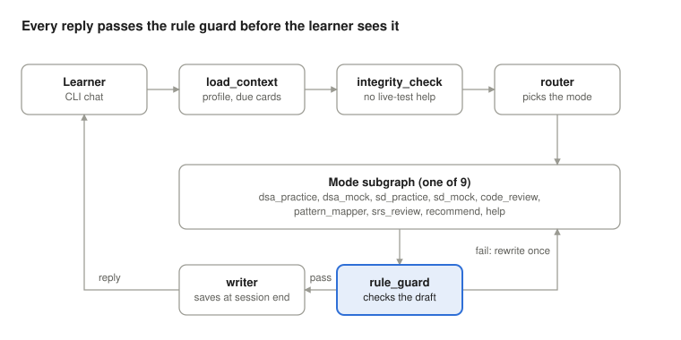

# DSA_SD_COACH_4Oct2026 — Agent Design

Oct 4, 2026 · Srini G · Live version: https://claude.ai/code/artifact/b56e69c2-2b0b-48e0-8164-ccb48dc57f99

Code blocks from the live doc are kept as real files in this repo and linked below, so there is one copy of each.

## Overview

DSA_SD_COACH_4Oct2026 is a LangGraph agent that coaches one learner through DSA and system design practice, mocks, code review, pattern mapping and spaced repetition, and keeps their progress log itself.

**Design principle:** the model judges and talks; the graph enforces. Every rule from SKILL.md and the Project instructions (Step 2) is a state check, so a hint tier cannot be skipped and code cannot leak, however the learner phrases the request.

| Layer | Choice | Role |
| --- | --- | --- |
| Orchestration | LangGraph | Router, mode subgraphs, step gates, rule guards, checkpointing |
| Model and tools | LangChain | Model calls (Claude by default, swappable), structured output, tool calling |
| Knowledge | Knowledge pack (02), split per section | Loaded per node, never whole (Step 3) |
| Storage | SQLite for v1, Postgres later | Profile, session records, cards, progress log (Step 4) |
| Observability | Langfuse | One trace per session, evals on every coach reply |
| Interface | CLI first, then a web chat | Open decision |

**First learner:** Junior, Python, targeting Google, Meta, Microsoft and Amazon; weak in sorting and trees; exploratory timeline.

## Architecture

Each learner message runs the same pipeline; only the mode subgraph in the middle changes.



A draft that fails the rule guard goes back to its subgraph once with the reason; a second failure falls back to a safe Socratic question. Live-interview requests stop at integrity_check with a redirect to practice.

## State schema

One typed state object carries everything the guards check; the LangGraph checkpointer saves it after every node, so a session survives a restart. See [`app/state.py`](../app/state.py).

## Nodes and subgraphs

Every turn runs load_context, then router, then one mode subgraph, then the guard and the writer; only the subgraph changes by mode.

| Node | Does | Reads | Writes |
| --- | --- | --- | --- |
| load_context | Loads profile, due cards, last 5 log entries | Storage | profile, due list |
| integrity_check | Refuses live-interview or contest help; redirects to practice | Message | Flag |
| router | Picks the mode; asks one question if unclear | Message, routing examples (pack 3) | mode |
| dsa_practice | Step-gated coaching (below) | Pack 4, calibration (pack 2) | step, flags, hint_level |
| dsa_mock | Persona, timed phases, silent until debrief | Pack 5 | phase times, blocked_turns |
| sd_practice | 6 steps, estimation checks | Pack 6 | step |
| sd_mock | Staff persona, one curveball | Pack 7 | curveball_used |
| code_review | Correctness, complexity, quality, verdict | Pack 8 | verdict |
| pattern_mapper | Asks input, output, constraints, objective, signals, then names | Packs 9 and 10 | pattern |
| srs_review | Shows name only; advance, hold or reset | Pack 13, cards | card stage |
| recommend | Ranks gaps from stored records | Pack 15, log | none |
| help | Static menu, no model call | Pack 14 | none |
| rule_guard | Checks the draft reply (next section) | State | Approved reply or rewrite |
| scoring | Self-rating first, then coach scores and gap | Rubric | scores |
| writer | Saves card, session record and log entry; says "saved" only on success | State | Storage |

**DSA practice step gates** (each step opens only when the previous gate passes):

1. Setup: restate and clarify. Gate: learner restated or asked a question.
2. First instinct. Gate: any approach offered.
3. Brute force with complexity. Gate: `brute_force_given`.
4. Bottleneck and optimize, with the hint ladder. Gate: optimized approach stated.
5. Dry run on a small example. Gate: `dry_run_done`.
6. 30-second pitch: approach, complexity, edge cases, why over the alternative.
7. Learner codes, then walks through it line by line. Sets `attempted`.
8. Self-rating, coach scores, one improvement, pattern card, 2 to 3 related problems. Sets `session_complete`.

## Rule guards

The rule_guard node checks every draft reply before it is sent; a failed check sends the draft back to the model once with the reason, and a second failure falls back to a safe question.

| Guard | Fails when | Action |
| --- | --- | --- |
| Hint tier | Requested tier is more than hint_level + 1 | Serve hint_level + 1 only |
| Pattern-name leak | Tier 1 or 2 reply contains any of the 15 pattern names or a data-structure name | Rewrite without the name |
| Code leak | Reply has a code block and code_allowed is false | Strip code; ask for the learner's attempt |
| Solution before attempt | Reply states the full approach before brute_force_given | Replace with a brute-force question |
| Dry run gate | Step is code but dry_run_done is false | Return to the dry run step |
| Mock silence | Mock reply gives feedback before debrief and blocked_turns is under 3 | Remove feedback; neutral probe only |
| Curveball cap | Second curveball in an SD mock | Remove it |
| Scores order | Coach scores shown before self_scores exist | Ask for self-rating first |
| Honest saving | Reply says "saved" without a successful write | Remove the claim |
| Quiet learner | Learner's last 2 turns had no reasoning | Append "Talk me through what you're thinking right now." |

The blocked_turns threshold of 3 is a starting value to tune with evals.

## Prompts and knowledge layout

Rules live in code, persona and flows live in versioned prompt files, and the knowledge pack is split so each node loads only its slice. Local home: `C:\Users\glsri\repos\aaroh\DSA_SD_Coach\DSA_SD_Coach_04Oct2026`.

```text
DSA_SD_Coach_04Oct2026/
  app/
    graph.py            # builds the LangGraph graph
    state.py            # CoachState
    nodes/              # one file per node and subgraph
    guards.py           # rule_guard checks
    scoring.py          # rubrics, self vs coach gap
    srs.py              # advance / hold / reset, due dates
    storage.py          # SQLite access
    tools.py            # LangChain tools
    cli.py              # entry point: python -m app.cli
  prompts/
    core.md             # identity + hard rules (from 01)
    modes/              # one prompt per mode
  knowledge/            # 02 split by section
    calibration.md  routing.md  dsa_flow.md  question_bank.md
    mocks.md  sd_flow.md  code_review.md  patterns.yaml
    srs.md  recommend.md  help.txt
  templates/
    pattern_card.md  design_card.md  progress_update.md
  evals/
    datasets/  run_evals.py
  data/coach.db         # created on first run
  launch_coach.bat      # used by the desktop shortcut
  .env                  # API keys (never committed)
```

`patterns.yaml` holds the signal-word table and the 15 pattern names, so the pattern mapper and the leak guard read the same list.

## Storage schema

Three tables and a view replace the ChatGPT progress-log chat; the progress log the learner sees is a query over them, exportable to Markdown in the 03 format. See [`sql/schema.sql`](../sql/schema.sql), which also seeds today's incomplete Maximum Depth of Binary Tree session.

## Tools

The model gets read tools freely, but every write goes through the writer node, so nothing is saved mid-session by accident.

| Tool | Purpose | Called from |
| --- | --- | --- |
| get_profile | Profile for calibration | load_context |
| update_profile | Change a field on request ("my weak area is now graphs") | Any mode |
| pick_problem | Problem by topic, level and weak areas, skipping solved ones | dsa_practice, dsa_mock |
| get_due_cards | Cards due today | load_context, srs_review |
| get_history | Recent sessions and scores | recommend |
| check_estimate | Recomputes QPS, storage and bandwidth from the learner's inputs | sd_practice |
| run_tests | Runs learner code against test cases (only if that decision is yes) | code_review |
| save_session | Session record, card and log entry | writer only |
| export_log | Progress log as Markdown in the 03 format | On request |

## Observability and evals

Langfuse records one trace per session with a span per node; evals score whether the coach followed its own rules, not just whether it sounded good.

**Trace tags:** learner_id, mode, step, hint_level, prompt version, knowledge-pack version, guard failures.

| Eval | Type | Pass condition |
| --- | --- | --- |
| Answer leakage | LLM judge | No full approach before an attempt |
| Pattern-name leakage | Rule (patterns.yaml) | No pattern name in tier 1 or 2 replies |
| Unrequested code | Rule | No code block unless code_allowed |
| Hint ladder order | Rule over trace | Tiers served 1, 2, 3 in order |
| Router accuracy | Labelled set from pack 3 | Correct mode for each example message |
| Tone | LLM judge | Honest and specific, no cheerleading |
| Score calibration | Human spot check | Coach scores match the rubric definitions |

**Eval datasets:** scripted learner transcripts, including adversarial ones ("just give me the answer", "hint hint hint" on turn 1, a learner who never replies to the problem, as happened in the first session). Every prompt or pack change runs the full set before it ships.

## Build plan

Build the smallest loop that proves the guards work, then widen to the other modes.

1. **Skeleton:** state, router, help, SQLite storage, profile load, CLI. Import the existing Progress Log row.
2. **DSA practice end to end:** step gates, hint ladder, rule guards, scoring, pattern card, writer. Test on Maximum Depth of Binary Tree.
3. **Langfuse and evals:** tracing on every node, the rule-based evals, the adversarial transcripts.
4. **Retention:** SRS review, recommendation, progress log export.
5. **Other modes:** code review, pattern mapper, then DSA mock.
6. **System design:** practice, then mock with the curveball cap and design cards.
7. **Interface:** desktop shortcut now; web chat if wanted later.

Phases 1 and 2 are enough to start coaching yourself through your weak areas, sorting and trees.

## Desktop shortcut

A desktop icon named DSA_SD_COACH_4Oct2026 opens a terminal and starts the coach. It runs [`launch_coach.bat`](../launch_coach.bat), and is created once by [`create_shortcut.ps1`](../create_shortcut.ps1):

```powershell
powershell -ExecutionPolicy Bypass -File create_shortcut.ps1
```

If the web chat comes later, only the last line of the batch file changes (for example to `streamlit run app/web.py`).

## Decisions still open

Six choices change the build; the design assumes the first option in each until you decide.

- [x] Users: just you (assumed), or many learners with login, as the classroom notes in pack 16 suggest?
- [x] Code execution: review only (assumed), or run learner code in a sandbox via run_tests?
- [x] Problem bank: curated list of problems with tests (assumed), or model-generated?
- [x] Langfuse: cloud free tier (assumed), or self-hosted?
- [x] Interface after the CLI: none yet (assumed), or a Streamlit web chat?
- [ ] Blocked check for mocks: is 3 stuck turns the right trigger for one nudge?
